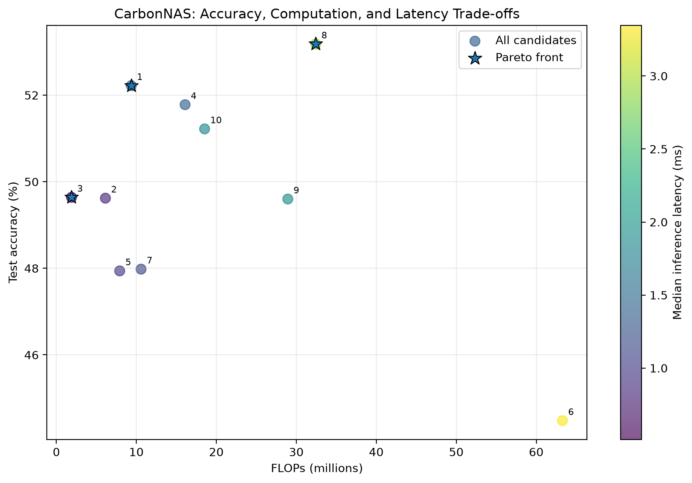
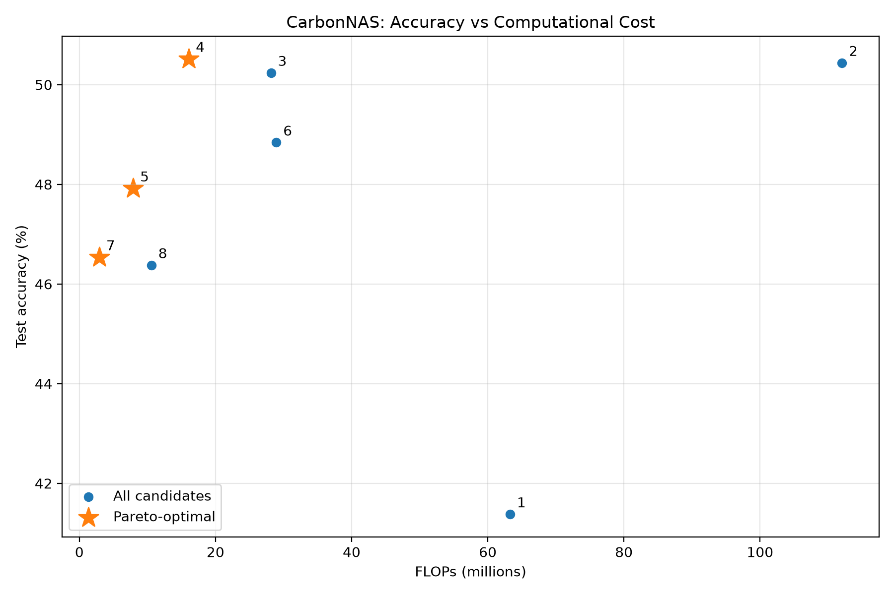

# CarbonNAS: Experimental Setup and Results

## 1. Overview

This document describes the experiments implemented in CarbonNAS to investigate trade-offs between CNN classification accuracy and computational efficiency.

The current prototype uses a configurable CNN search space, random candidate generation, CIFAR-10 classification experiments, repeated CPU latency measurements, and three-objective Pareto analysis.

Energy measurement, carbon-emission estimation, and carbon-aware runtime selection remain planned extensions.

## 2. Experimental Setup

### Dataset

The experiments use CIFAR-10, a dataset of images from ten classes.

For the preliminary accuracy experiments:
- Training subset: 10,000 images
- Test subset: 5,000 images
- Training duration: 2 epochs per candidate

The results provide an initial comparison rather than a definitive evaluation of fully trained models.

### Architecture Search Space

Candidate CNNs are generated using different combinations of:
- Channel configurations
- Convolution kernel sizes
- Pooling settings

Ten unique candidate architectures were evaluated in the current experiment.

### Accuracy Evaluation

Each candidate was trained and evaluated using the same subset sizes and training schedule. The measured test accuracy was recorded alongside the candidate's computational metrics.

### Latency Benchmarking

Inference latency was measured on a CPU with a batch size of one.

The benchmark used:
- 20 warm-up runs
- 7 repeated measurements
- 100 inference runs per measurement

The median latency across the repeated measurements was used for comparison. Latency can vary with hardware and system conditions.

## 3. Evaluation Objectives

The current Pareto analysis considers three objectives:

1. Maximize test accuracy.
2. Minimize FLOPs.
3. Minimize inference latency.

An architecture is Pareto-optimal when no other evaluated architecture is at least as good on every objective and strictly better on at least one.

### Preliminary Results

The latest experiment evaluated ten sampled CNN architectures using a subset of CIFAR-10. Each candidate was trained for two epochs on 10,000 training images and evaluated on 5,000 test images.

The current three-objective Pareto analysis considers test accuracy, FLOPs, and median CPU inference latency. It identified the following non-dominated candidates:

| Candidate | Test Accuracy | FLOPs | Median CPU Latency |
|---|---:|---:|---:|
| 3 | 49.64% | 1.89M | 0.5113 ms |
| 1 | 52.22% | 9.36M | 1.3513 ms |
| 8 | 53.18% | 32.43M | 2.8558 ms |

Candidate 3 has the lowest computational cost and latency among these Pareto-optimal candidates. Candidate 8 achieves the highest measured accuracy, but with higher computational cost and latency. Candidate 1 represents an intermediate trade-off.



*Figure: Test accuracy versus FLOPs, with color representing median inference latency and stars identifying Pareto-optimal candidates.*

**Limitations:** These results are preliminary because each candidate was trained for only two epochs and evaluated on a test subset. Latency was measured on a CPU and may vary across hardware and system conditions. Energy measurement, carbon-emission estimation, and carbon-aware runtime selection remain future work.

For the detailed methodology, all candidate results, and reproduction instructions, see [Experimental Setup and Results](docs/experiments.md).

## 5. Pareto Visualization



The figure plots test accuracy against FLOPs, with color representing median inference latency. Star markers identify the Pareto-optimal candidates.

- Preliminary candidate evaluation results (`results/nas_candidates.csv`)
- Combined accuracy and efficiency results (`results/nas_multiobjective_results.csv`)
- Three-objective Pareto-front results (`results/nas_pareto_front_3d.csv`)
- Pareto visualization (`results/figures/pareto_accuracy_flops_latency.png`)
- Experimental methodology and reproduction instructions (`docs/experiments.md`)


## 6. Limitations

The current experiments have several limitations:

- Each candidate was trained for only two epochs.
- Accuracy was evaluated on a subset of CIFAR-10.
- Latency measurements were collected in a CPU-only environment.
- Results may vary across hardware and system conditions.
- Energy consumption and carbon emissions have not yet been measured or estimated in this prototype.
- The current Pareto analysis covers accuracy, FLOPs, and latency, not energy or carbon.

## 7. Future Experiments

Planned extensions include:
- Longer training schedules and more extensive accuracy evaluation
- Sampling and evaluating additional architectures
- Comparing random search with guided search methods
- Measuring energy consumption where suitable tools or hardware are available
- Estimating carbon emissions using documented carbon-intensity assumptions
- Investigating runtime model selection under changing constraints

## 8. Reproducibility

From the repository root, the current experiment scripts can be run with:

```powershell
python experiments/nas_accuracy.py
python experiments/pareto_multiobjective.py
```

The first command trains and evaluates the sampled candidates. The second calculates the Pareto frontier and generates the visualization.

The required environment and dependencies must be installed before running the experiments. The scripts may overwrite their corresponding result files.

## Documentation
See [Experimental Setup and Results](docs/experiments.md) for the experimental methodology, candidate comparisons, latency benchmarks, and Pareto analysis.
